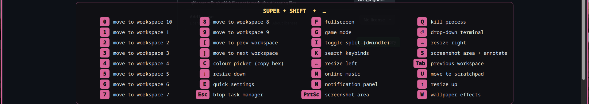

<div align="center">

# hypr-whichkey

**Hold <kbd>SUPER</kbd>. See every shortcut. Add <kbd>SHIFT</kbd>, <kbd>CTRL</kbd> or <kbd>ALT</kbd> to narrow it down.**

A which-key style overlay for [Hyprland](https://hyprland.org), shown like movie subtitles.
It reads *your* keybinds live and matches *your* theme, so there's nothing to configure.



</div>

---

## Why

You set up 80 keybinds, and a week later you remember 12 of them. Cheat-sheet scripts make you open a menu and search. hypr-whichkey works like the which-key menu in Neovim, but for your whole desktop:

- **Appears while you hold SUPER** (after 400 ms, so quick shortcuts never flash it)
- **Narrows live**: press <kbd>SHIFT</kbd> while holding SUPER and the list changes to `SUPER + SHIFT` binds
- **Never steals focus**: keep typing your shortcut and the overlay disappears when you let go
- **Always matches your config**: it reads `hyprctl binds` every time it opens, so a reload is reflected immediately
- **Matches your theme automatically**: pywal, wallust or your Hyprland border colour
- **Multi-monitor**: shows on the screen you're working on
- **Works with both config styles**: classic `hyprland.conf` and the new Lua config (0.57+)

## Install

**Requirements:** Hyprland and [Quickshell](https://quickshell.org) (`qs`).

| Distro | Quickshell |
|---|---|
| Arch | `pacman -S quickshell` |
| Fedora | `dnf copr enable errornointernet/quickshell && dnf install quickshell` |
| NixOS | `pkgs.quickshell` |

```sh
git clone https://github.com/MerelyPerfect/hypr-whichkey
cd hypr-whichkey
./install.sh
```

The installer detects whether you use `hyprland.conf` or `hyprland.lua`, shows the two lines it needs, and only adds them if you agree (it makes a backup first). Then **hold SUPER**.

<details>
<summary>Manual install</summary>

```sh
mkdir -p ~/.config/quickshell/hypr-whichkey ~/.config/hypr-whichkey ~/.local/bin
cp quickshell/shell.qml   ~/.config/quickshell/hypr-whichkey/
cp drivers/whichkey.*     ~/.config/hypr-whichkey/
cp drivers/hypr-whichkey  ~/.local/bin/
```

**hyprland.conf**
```ini
source    = ~/.config/hypr-whichkey/whichkey.conf
exec-once = qs -c hypr-whichkey -d
```

**hyprland.lua**
```lua
dofile(os.getenv("HOME") .. "/.config/hypr-whichkey/whichkey.lua")
hl.on("hyprland.start", function() hl.exec_cmd("qs -c hypr-whichkey -d") end)
```
</details>

Uninstall: `./install.sh --uninstall`

## Get the nicest labels

hypr-whichkey shows each bind's **description** if it has one. If it doesn't, you get a readable fallback such as `run firefox` or `movefocus l`.

```ini
# hyprland.conf: use bindd (the d means "described")
bindd = SUPER, Return, Open terminal, exec, kitty
```
```lua
-- hyprland.lua
hl.bind(mod .. " + Return", hl.dsp.exec_cmd("kitty"), { description = "Open terminal" })
```

> In Lua configs, binds that call your own functions (closures) have no readable fallback, so give those a `description`.

## Configure (optional)

Create `~/.config/hypr-whichkey/config.json`. Every key is optional, and changes apply live without a restart.

```jsonc
{
  "size": "medium",          // small | medium | large | any number (1.0 = medium)
  "delay": 400,              // ms SUPER must be held before showing
  "position": "bottom",      // bottom | top
  "offset": 60,              // px from the screen edge
  "maxColumns": 4,
  "rowsPerColumn": 8,
  "onlyDescribed": false,    // true = hide binds without a description
  "hide": ["^mouse"],        // regexes matched against "<key> <label>"
  "font": "JetBrainsMono Nerd Font",   // default: your system monospace font
  "opacity": 0.95,
  "theme": { "accent": "#7dd3fc", "background": "#101014", "foreground": "#f5f5f5", "header": "#ffd479" }
}
```

### Theme detection order
1. `theme` in `config.json`
2. `~/.cache/wal/colors.json`: **pywal**, or **wallust** / **matugen** with a pywal-style template
3. Hyprland's `general:col.active_border` used as the accent colour
4. A built-in dark theme

### Blur behind the overlay
```ini
layerrule = blur, hypr-whichkey                         # hyprland.conf
```
```lua
hl.layer_rule({ match = { namespace = "^hypr-whichkey$" }, blur = true })   -- hyprland.lua
```

## How it works

```
 Hyprland ──(SUPER held)──► driver ──writes "65 DP-1"──► $XDG_RUNTIME_DIR/hypr-whichkey
                                                               │ (file watch)
                       hyprctl -j binds ──► Quickshell overlay ◄┘ → filters binds for that exact modifier mask
```

- **Lua driver:** a 50 ms `hl.timer` checks `hl.is_key_down`. It's cheap and handles any modifier combination.
- **conf driver:** non-consuming `bindn`/`bindrn` binds on the modifier keys call a small shell script. Your own binds are not affected.
- The state file is the whole interface: any other tool can write `"<modmask> <monitor>"` to drive the overlay.

Modifier mask values: `SHIFT=1 CTRL=4 ALT=8 SUPER=64`.

## Troubleshooting

| Symptom | Fix |
|---|---|
| Nothing appears | Is it running? `pgrep -af hypr-whichkey`. Test it directly: `echo "64 $(hyprctl -j monitors \| jq -r '.[]\|select(.focused).name')" > $XDG_RUNTIME_DIR/hypr-whichkey` |
| Appears but empty | Your SUPER binds may be closures with no description (Lua), or you set `onlyDescribed: true` |
| Stays visible after release (conf) | Usually a keyboard remap or a missed release event. Tap SUPER again, and please open an issue with your layout |
| Wrong colours | Set `theme` in `config.json` |
| Logs | `qs -c hypr-whichkey` in a terminal |

## Roadmap

- [ ] Submap support (show the binds of the active submap)
- [ ] Group binds by category
- [ ] AUR / COPR / Nix flake packages

PRs are welcome, especially screenshots with other themes.

## License

[MIT](LICENSE)
